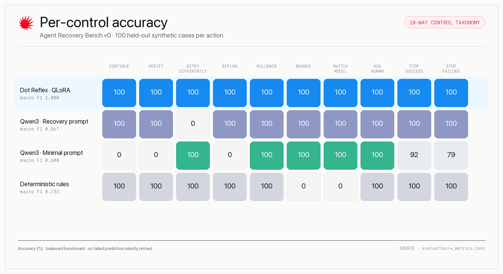
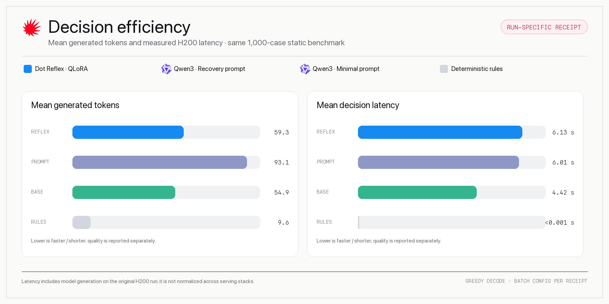
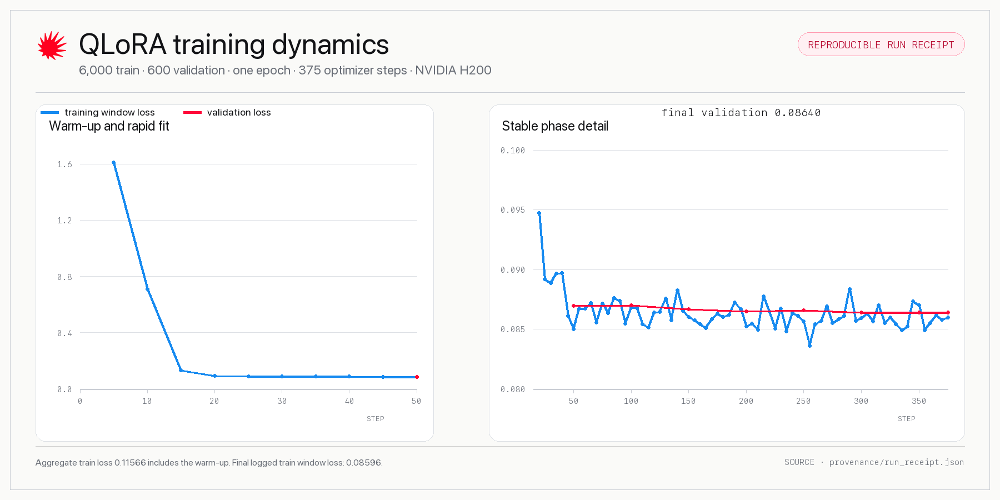

# Evaluation report

## Scope

The published evaluation answers a narrow question: did the adapter learn to
select the intended recovery control on held-out examples generated under Agent
Recovery Bench v0, and can it improve outcomes in that benchmark's stateful
simulator?

It does **not** answer whether Dot Reflex generalizes to real repositories,
independently authored incidents, production agents, or arbitrary harnesses.
It is not SWE-bench and it does not measure issue-resolution rate.

## Evaluation sets

| Set | Size | Purpose |
|---|---:|---|
| Static benchmark | 1,000 | Balanced 10-way action classification, 100 cases per action |
| Stateful simulator | 200 episodes | Recovery outcome after a controller decision |

The generator used benchmark-only application domains and held-out template
family IDs. Exact canonical input hashes were checked for disjointness across
training, validation, benchmark, and simulator splits. Template disjointness is
not the same as independent authorship.

## Controllers

1. A deterministic rule controller.
2. Untouched Qwen3-14B-Base with a minimal action prompt.
3. Untouched Qwen3-14B-Base with the strongest fixed recovery prompt.
4. The Dot Reflex QLoRA adapter with that recovery prompt.

Neural controllers used `Qwen/Qwen3-14B-Base` at revision
`0b0bd3732e2c374d483664439ea334928b65f304`. Generation was greedy. Parse errors
were counted; no failed example was silently retried.

## Aggregate results

| Controller | Accuracy | Macro F1 | Simulator success | ECE ↓ | Parse success |
|---|---:|---:|---:|---:|---:|
| Deterministic rules | 0.800 | 0.733 | 0.800 | 0.138 | 1.000 |
| Qwen3-14B, minimal prompt | 0.671 | 0.608 | 0.785 | 0.671 | 0.892 |
| Qwen3-14B, recovery prompt | 0.900 | 0.867 | 1.000 | **0.053** | 1.000 |
| Dot Reflex adapter | **1.000** | **1.000** | **1.000** | 0.070 | 1.000 |

Expected calibration error uses ten bins. Lower is better. The adapter was
perfectly accurate on this set but not perfectly calibrated; its ECE was 0.070,
slightly worse than the fixed recovery prompt's 0.053.

## Per-action static accuracy

| Action | Rules | Minimal prompt | Recovery prompt | Dot Reflex |
|---|---:|---:|---:|---:|
| `continue` | 1.00 | 0.00 | 1.00 | 1.00 |
| `verify` | 1.00 | 0.00 | 1.00 | 1.00 |
| `retry_differently` | 1.00 | 1.00 | 0.00 | 1.00 |
| `replan` | 1.00 | 0.00 | 1.00 | 1.00 |
| `rollback` | 1.00 | 1.00 | 1.00 | 1.00 |
| `branch` | 0.00 | 1.00 | 1.00 | 1.00 |
| `switch_model` | 0.00 | 1.00 | 1.00 | 1.00 |
| `ask_human` | 1.00 | 1.00 | 1.00 | 1.00 |
| `stop_successfully` | 1.00 | 0.92 | 1.00 | 1.00 |
| `stop_failure` | 1.00 | 0.79 | 1.00 | 1.00 |

## Efficiency measurements

| Controller | Mean generated tokens | Mean decision latency | P95 decision latency |
|---|---:|---:|---:|
| Deterministic rules | 9.6 | 0.002 ms | 0.002 ms |
| Qwen3-14B, minimal prompt | 54.9 | 4.423 s | 4.930 s |
| Qwen3-14B, recovery prompt | 93.1 | 6.011 s | 6.758 s |
| Dot Reflex adapter | 59.3 | 6.131 s | 6.237 s |

These are receipts from the original H200 run. They are not normalized serving
benchmarks and should not be extrapolated to other GPUs, batch sizes, runtimes,
or quantization formats.

## Safety-oriented diagnostics

All four controllers scored:

- false-completion detection: 1.000;
- loop interruption: 1.000;
- unsafe-continue rate: 0.000;
- false-stop rate: 0.000.

The result indicates that these synthetic slices were too easy to distinguish
between controllers. It does not demonstrate zero real-world safety failures.

## Training diagnostics

The completed one-epoch run used 6,000 synthetic training trajectories and 600
validation trajectories. Training ended after 375 optimizer steps. Aggregate
training loss was 0.11566; the last validation loss was 0.08640. The large early
loss drop and then flat validation curve are visible below.

## Receipts

Aggregate raw JSON receipts are included without rewriting:

- `evaluation/heuristic_metrics.json`
- `evaluation/base_metrics.json`
- `evaluation/prompt_only_metrics.json`
- `evaluation/adapter_metrics.json`
- `provenance/run_receipt.json`
- `provenance/full_training_summary.json`

The chart generator in `scripts/generate_charts.py` reads those receipts and
recreates the publication charts. `evaluation/chart_receipt.json` records the
sources and chart digests.

## Transfer status

A separate 40-case, independently authored transfer pilot was prepared in the
private research workspace. Only its deterministic controller completed because
no isolated evaluation GPU was available. No neural transfer score is published
here. A transfer result should be added only after all four controllers run on
the frozen cases with raw predictions and no cherry-picking or silent retries.

## Acceptable claims

Accurate:

- “Dot Reflex reached 100% action accuracy on its 1,000-case held-out synthetic
  Agent Recovery Bench v0.”
- “The adapter reduced output tokens relative to the strongest fixed recovery
  prompt in that run.”
- “Production and independently authored transfer performance remain unproven.”

Not supported:

- “Dot Reflex solves SWE-bench.”
- “Dot Reflex is universally safer than frontier agents.”
- “Dot Reflex prevents all unsafe continuation or false completion.”
- “Dot Reflex has proven production reliability.”

